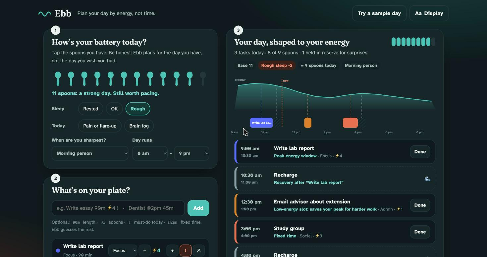

# Ebb 🌊

**Plan your day by energy, not time.**

**Live:** https://davidandree.github.io/ebb/. No sign-up. Runs entirely in your browser.



## The user, the barrier, the change

**User:** people whose limiting resource is **energy, not hours**: people with ADHD, chronic illness (long COVID, ME/CFS, fibromyalgia, migraine, autoimmune conditions), depression, or burnout. Many describe their energy in "spoons" ([spoon theory](https://en.wikipedia.org/wiki/Spoon_theory)).

**Barrier:** every planner assumes all hours are equal and that you can do everything on the list. For these users that leads to a predictable cycle: over-commit on a good morning, crash by afternoon, lose the next day too ("boom and bust"). Clinicians recommend *pacing*, but doing it by hand every morning takes exactly the executive function and energy they're short on.

**Change:** a 20-second morning check-in turns into a paced plan.

| Before | After Ebb |
|---|---|
| 8 tasks on a list, no idea what's realistic on a day after bad sleep | "9 spoons today": 3 tasks placed, 1 spoon held in reserve, 4 moved to tomorrow with a reason each |
| Hardest work lands whenever there's a gap | The lab report goes in your 9 am peak; email and calls go in the post-lunch dip |
| No recovery planned | A recharge block automatically follows heavy work |
| The same mistakes every week | After you rate a task "heavier than expected", Ebb learns that, for example, admin costs *you* 15% more |

## How it works

1. **Check-in.** Pick your spoons (1–12), how you slept, and whether you have pain or brain fog. Ebb shows exactly how each factor changes today's budget (e.g. *Base 11 · Rough sleep −2 = 9 spoons*).
2. **Tasks.** Use natural quick-add: `Write essay 90m ⚡4 !` (90 minutes, 4 spoons, must-do) or `Dentist @2pm 45m` (fixed time). Ebb guesses the kind (focus, admin, physical, social) and a cost when you leave them out.
3. **Planning** (`docs/js/planner.js`, a pure function tested in `tests/`):
   - Your chronotype (morning, midday or night owl) gives an energy curve, lowered after rough sleep.
   - Fixed-time tasks are placed first. Must-dos and heavy or focus tasks then claim the highest-energy windows. Light tasks go in dips, which saves your peaks.
   - Back-to-back heavy blocks are avoided, and a **recharge** follows heavy work.
   - A **pacing reserve** (about 12% of the budget) is held back. Only must-dos can spend it.
   - Anything that doesn't fit goes to **Tomorrow, gently**, each with a plain-language reason.
   - Brain fog makes focus work cost one more spoon.
4. **Learning.** Tap *Done* and say whether it felt lighter, about right, or heavier. Ebb nudges that task kind's cost multiplier (bounded to 0.6–1.6×) and tells you what it learned.
5. **Take it with you.** Export to your calendar (`.ics`, with 5-minute reminders) or copy the plan as text.

## Accessibility

Accessibility is part of the core design, not an add-on:

- **Atkinson Hyperlegible** by default (designed by the Braille Institute for low-vision readers), with **Lexend** as an alternative for easier reading. Both switch instantly.
- Text size (100 / 115 / 130%), light/dark theme, reduced motion and high contrast, all remembered on this device.
- Fully keyboard operable: the spoons are an ARIA radio group with arrow keys, every timeline block is focusable with a spoken description, and focus outlines are clearly visible.
- 44px+ touch targets, a mobile layout, a skip link, and polite live regions for plan updates.
- Plain, non-judgemental language: deferred tasks are "Tomorrow, gently," not "overdue."

## Market

- **Large, underserved users:** an estimated 4–5% of adults have ADHD; long COVID alone affects millions in the U.S.; and chronic fatigue and burnout are widespread among students and caregivers.
- **Proven demand:** ADHD-focused planners such as Tiimo and Structured have large user bases and paid tiers, which shows people pay for planners built for how their brains work.
- **The gap:** spoon and energy trackers *log* energy, and planners *schedule* time. Ebb is the first to **schedule your day around today's energy and learn your personal costs**. Natural next steps: a wearable or HRV signal in the check-in, and sharing plans with a care team or coach.

## Run it locally

```bash
git clone https://github.com/DavidAndree/ebb.git && cd ebb
npm test          # planner tests (Node 18+)
npm run serve     # http://localhost:8000
```

No build step, no dependencies, no API keys.

## Project structure

```
docs/index.html        page (served by GitHub Pages)
docs/css/app.css       design system, themes, accessibility modes
docs/js/planner.js     pure planning engine: budget, energy curve, placement, learning, quick-add parser
docs/js/app.js         UI: check-in, tasks, timeline, learning dialog, calendar export
tests/planner.test.mjs engine tests
```

## Limitations

- The energy curves are general chronotype shapes, not personal measurements. You choose the closest one, and the learning loop personalizes costs rather than the curve itself.
- Ebb is a planning aid, not medical advice.
- Data lives in this browser only. There's no sync between devices yet.

## Credits and disclosure

Spoon theory by Christine Miserandino. Fonts: Atkinson Hyperlegible (Braille Institute), Lexend and Fraunces via Google Fonts.

**AI-assisted development:** built with Claude (Anthropic) as an AI coding assistant for code, design and docs. Product decisions, testing and the submission are my own. Ebb itself uses no AI and makes no network calls after loading.

**License:** MIT
